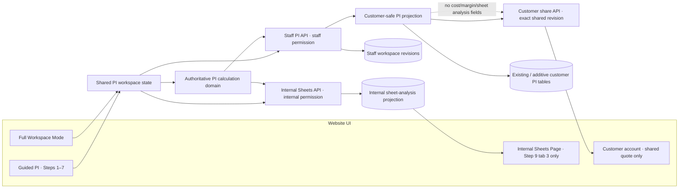

# Proforma Invoice conversion architecture

**Decision record status:** Implementation architecture for the user-authorized conversion, based on the selected ADV `main` baseline in `WPF_PROFORMA_SOURCE_AUDIT.md` and the current website gaps in `PI_WEBSITE_IMPLEMENTATION_GAP.md`. Implementation is authorized in controlled phases. Do not change remote Supabase/Vercel settings speculatively; local schema review does not prove deployed state. The Bento/Neon visual redesign remains gated on showing both prototypes and receiving explicit approval.

## 1. Product boundaries

The website should have three intentionally separate product surfaces:

1. **Customer inquiry intake** — the existing customer-only technical request flow remains a distinct request channel. Its current local technical spec and cut-layout preview are not a priced WPF quote and must not be relabeled as one.
2. **Staff PI workspace** — a staff-authenticated, persistent, guided conversion of WPF Steps 1–7. It creates a complete customer-safe quotation. It excludes Step 8 entirely.
3. **Internal Sheets analysis** — only WPF Step 9 → tab 3 → Sheets Page, accessible from an internal staff workspace/report route, not a customer step. The other Step 9 tabs are not in the PI Generator scope.

Customer share/export is a separate boundary from staff calculation. Internal purchase prices, sheet use/wastage values, optimization utilization, internal charge cost, margin and profitability never enter customer request DTOs, account endpoints, search, logs, notifications, document renderers or share payloads.

## 2. Logical architecture

The drawing represents a proposed separation, not the current database. Current repository migrations are local contracts only; deployed schema and roles were not changed or remotely probed during this source audit.

### 2.1 Domain modules

- **Workspace aggregate:** stable IDs for PI, group/spec section, charge row, term clause and grid row; company, customer and project inputs; Step 4 parameters and provenance; Step 5 cut-list rows and overrides; Step 6 charge/wastage inputs; Step 7 summary/terms; revision metadata and last completed guided stage.
- **Calculation domain:** deterministic decimal functions for Step 4 selling rates, Step 5 area/line pricing, Step 6 charge/wastage values and Step 7 financial waterfall. These functions accept typed input snapshots and return derived values plus explicit warning/validation results. They do not read React state, issue database calls, mutate inventory or generate markup.
- **Customer document projection:** an explicit allowlist containing issuer/customer/project details, approved quote lines, selling subtotal, allowed other-charge line items, discount, VAT, grand total, terms and status/revision wording. It contains no internal cost inputs or analysis.
- **Internal Sheets projection:** only the data needed to reproduce the WPF Sheets page: selected pane/source sheet identity, sheet size/rate source, Step 6 sheet quantity/utilization/charge references, optimization provenance, shared-rack allocations, buy/use/waste values, shortfall/review diagnostics and internal exports.
- **Persistence adapters:** separate staff workspace, customer publication/share, internal analysis, and optional Sheet Store adapters. The user session/token is passed to server-side, user-scoped calls. Avoid service-role bypasses for user-driven reads/writes.

## 3. Guided experience and Full Workspace Mode

### Guided Mode (Steps 1–7)

One continuous wizard with stable document header and identity, stage progress, next/back/direct navigation, inline errors, progressive disclosure, unsaved/saved status and interruption-safe save. Conditional Step 4 inputs expose only the selected SGU/DGU/LAM/DGU+LAM configuration; advanced parameters are revealed on demand while remaining in the same stage. Step 7 is the quote preview and final customer-safe validation point.

### Full Workspace Mode

A user may switch to a denser workspace arrangement with the same stages and same underlying store. It is not a separate editor, second draft, alternate calculation path or page reload that creates a new revision. Switching mode must preserve unsaved inputs, active group/row, warning acknowledgments and calculated preview. Guided and full modes must call the same domain functions and persistence commands.

### Internal Sheets Page

The internal page is not a Step 8 or customer-facing step. Place it behind internal navigation and authorization (for example an internal “Analysis” pane accessible only to the approved staff role). Do not expose a customer-visible route, step count, navigation link, endpoint, file link or screen-reader flow that reveals its presence or data to a customer. Page is limited to WPF Sheets functionality; no Overview, Services or Specs tabs.

### Bento and Neon themes

Use semantic tokens and shared behavior, but provide genuinely distinct compositions:

- **Bento:** calm structured workspace, clear section cards and grid rhythm, restrained neutral surfaces, compact summaries and strong hierarchy.
- **Neon:** unmistakable high-contrast dark environment, deliberate luminous accents/edges, more expressive lighting and state feedback, while keeping labels, layout and affordances readable.

Do not implement Neon as a hue swap on Bento. The visual prototype must show both themes in the same representative states and same content, including guided form, Step 5 grid, Step 7 preview and internal Sheets access gate. Both must preserve keyboard/focus, contrast, reduced-motion, mobile layouts and visible validation. This prototype is a review artifact, not implementation approval.

## 4. Persistence, revisions and save semantics

### 4.1 Staff working document

Persist the full staff workspace in a staff-only revisioned aggregate (exact table design/migration is a later approval item). Include schema version, PI ID, revision, actor, timestamps, expected revision, idempotency key, workflow status, last stage, stable row IDs, all inputs and audit provenance. Store user-entered values, not only computed values; recompute all derived financial values on the server when saving/issuing. Preserve a snapshot of material provenance and Step 4/5 ownership/override state.

Recommended lifecycle:

1. Create an operator draft with a unique PI number under a database uniqueness constraint.
2. Save debounced checkpoints and stage transitions idempotently. Autosave is a draft write only—it does not share, issue, approve, alter status, publish a customer document, or consume inventory.
3. Use expected-revision optimistic concurrency and clear conflict resolution; an older browser tab cannot overwrite a newer revision silently.
4. Reopen from one canonical workspace revision and rederive calculations. A stale customer publication is never silently presented as current.
5. On deliberate issue/share, validate and persist the customer projection from that exact revision, then grant customer access only to that published revision.
6. Store internal Sheets data separately and only when authorized; recompute or version it with source revision and optimization provenance. It must not be embedded in the customer projection.

### 4.2 Existing website schema compatibility

The current website PI tables are a deliberately narrower line/rate model. Treat them as an existing published/customer contract, not as the full WPF workspace. Preferred migration path is additive and backward-compatible: keep current reads stable; add an approved staff-workspace contract and separate internal projection; map a selected saved revision into the customer-safe projection at issue/share time. Do not send WPF state wholesale into `inquiry_proformas`, and do not overwrite/drop current tables or policies speculatively. Exact table names, JSON shape, migration ordering and desktop interoperability require separate schema review and approval.

### 4.3 Data minimization and retention

Persist only data needed for quote continuity and internal sheet reporting. Do not persist a full Step 9 P&L snapshot in the customer publication. Avoid duplicate sensitive snapshots in logs, client storage, analytics, browser telemetry, notification email or error messages. Define deletion/retention for internal reports and worksheet revisions before migration.

## 5. API and authorization boundaries

Proposed resource boundaries (names are illustrative; do not implement from this list alone):

- **Staff workspace API:** authenticated staff read/write of the PI workspace, with per-inquiry access and existing idempotency/revision controls. Server validates role, scope, body schema, status lifecycle and current revision.
- **Customer publication/share API:** current customer-safe projection only. Preserve revision-scoped sharing and customer-token row-level access. Read DTOs are explicitly selected columns—never `select *` from the staff workspace.
- **Internal Sheets API:** a separate route/service requiring an explicit internal analysis permission and database RLS policy. It must return only the Sheets page projection. Internal permission must be checked server-side and by RLS; a hidden button or client-supplied `isInternal`/role flag is not authorization.
- **Internal export route:** CSV/XLSX/PDF output for the Sheets page only; private/no-store, no public caching/indexing, clear internal classification and same staff permission. It must not reuse customer quote download or share links.
- **Customer quote export:** renderer accepts `CustomerProformaDocument` only; no generic `ProformaInvoiceSnapshot` input. Exports always use the exact saved/shared customer revision and state whether unsaved edits are excluded.

Use the existing role model only after confirming the deployment role matrix. Do not invent a permission name or relax the current inquiry RLS policy. If current `inquiry_admin`/`inquiry_auditor` permissions are too broad for internal purchase data, add a narrowly scoped permission only through an approved additive migration and tested RLS change.

## 6. Calculation and validation ownership

- Port verified formulas into one pure, tested calculation package. Keep fixed-precision decimal semantics for AED and explicit rounding points for SQM, line value, discounts, VAT and summary totals; do not rely on IEEE floating-point multiplication for authoritative stored values.
- Client may calculate a responsive preview, but the server revalidates and recomputes before persistence, issue and export. Return a consistent validation contract with blocking errors and advisory warnings; do not accept submitted client totals as authority.
- Pin golden tests to the selected authoritative WPF source commit. Include boundary cases from `WPF_TO_WEB_PI_CONVERSION_MATRIX.md` and WPF tests identified in the source audit.
- **Split validator domains:** customer quote validator checks required issuer/PI/customer identity, dates, nonnegative customer line/charge values, discount cap and VAT/financial waterfall. Internal Sheets/P&L checks remain internal. Step 7 must not require the Step 9 margin calculation to save or issue a customer quote.
- Stock-consuming operations cannot be an incidental side effect of autosave. If WPF stock use is later exposed in web staff tooling, implement a dedicated explicit command with current-balance check, idempotency, transactional ledger/history, actor audit and authorized role.

## 7. Customer/internal separation tests

Treat this as a security invariant, not a UI convention:

1. Type/API schemas for customer documents have no fields for purchase cost, sheet price, quantity bought, utilization, yield premium, internal wastage value, margin, profit, internal notes, optimizer diagnostics or internal share metadata.
2. Supabase customer RLS permits only the owner account and exact published revision. Anonymous reads fail. Staff-only internal table policies are independent and deny customer tokens.
3. API tests assert customer routes cannot enumerate or fetch internal Sheet records, even with a valid customer token or manipulated query parameters.
4. Export snapshots and PDFs are generated from the customer projection only. No caller boolean such as `includeProfitLoss` can turn an internal document into a customer document.
5. Internal Sheets exports are separate artifacts with separate authorization and never appear in customer account listings, customer inquiry attachment lists or customer document API.
6. Logs/error responses/cache tags/analytics contain neither internal values nor internal resource existence for unauthorized callers. Customer failure messages remain generic.
7. Staff access to Sheets is enforced by server and DB policy for GET and each export operation, including direct URL access.

## 8. Controlled implementation phases and approval boundary

The user has authorized implementation of required backend, calculation, persistence, API/security and functional gaps in controlled phases. **The only explicit approval stop is the visual redesign:** before replacing/broadly restyling the existing interface, present both the Industrial Bento and Futuristic Neon prototypes in the same representative workflow and wait for explicit user approval. Backend gap work must not be blocked by that visual gate. Preserve existing uncommitted PI/account work and do not change remote Supabase/Vercel settings speculatively.

- **Phase A — Source baseline:** selected ADV `main` at `d862436c125c5a83ac86bdef9ccef34c587408b3`; the legacy repository and release differences are recorded in `WPF_PROFORMA_SOURCE_AUDIT.md`.
- **Phase B — Complete gap matrix:** give each WPF feature a status, exact source and website implementation references, delta, correction, dependencies and verification.
- **Phase C — Business functionality:** implement WPF-derived calculations, validation, live synchronization, import/export and workflow logic in tested vertical slices.
- **Phase D — Persistence/API/security:** add revisioned save/restore and authorization boundaries using additive, backward-compatible local changes; customer and internal Sheets DTOs/routes remain separate. Remote deployment state is not inferred from local SQL.
- **Phase E — UI and themes:** do not perform broad visual replacement before presenting both complete-theme prototypes and receiving explicit approval. Existing inquiry intake stays a distinct request flow unless separately approved to merge.
- **Phase F — Verification:** run available website tests/builds, WPF fixture comparisons, persistence/restore, mode-sync, customer/internal isolation, exports and staff authorization checks; report environment-limited tests honestly.

Step 8 stays excluded from the customer PI journey. Step 9 retains only Screen 3, Sheets Page, for authorized internal staff. Full Workspace Mode and Guided Mode must share one state and one calculation/persistence path.
