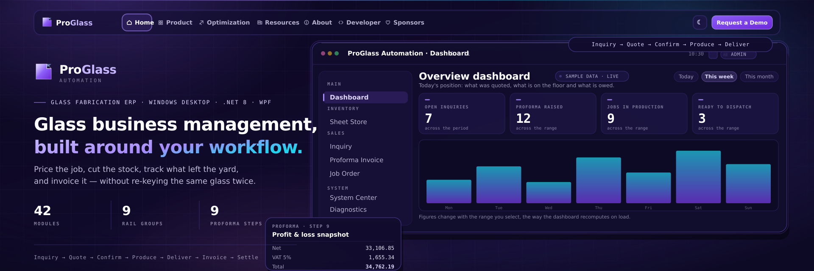

<div align="center">



# ProGlass Automation

### The Industrial Glass-Workshop ERP — from first quotation to final statement

**WPF · .NET 8 · C# 12 · MVVM · SQLite + EF Core · 15 Languages**

<br>


<br/>

`Inquiry ➜ Quote ➜ Confirm ➜ Produce ➜ Deliver ➜ Invoice ➜ Report` — **and every step carries the last forward.**

[📦 Repository](https://github.com/JUBERSALEEM/ProGlassAutomationADV) ·
[🗺️ Upgrade Roadmap](ERP_UPGRADE_ROADMAP.md) ·
[🎨 Design System](Docs/DESIGN_SYSTEM.md) ·
[🔬 Audits](Docs/AUDIT_FINDINGS.md) ·
[⚠️ Money-Path Error Policy](Docs/MONEY_PATH_ERROR_POLICY.md)

</div>

---

## 🧭 What is this?

ProGlass Automation is a professional Windows desktop platform built specifically around **glass fabrication businesses** — estimation, production, documentation, inventory, delivery, invoicing and reporting.

The defining property of Version 2 is **traceability**: every record carries who/what/when, every status mutation is audited, every money figure persists its calculation context, and the journey from a customer inquiry to the profitability of the delivered job is **one unbroken chain of records** — not five modules stapled together.

---

## ⛓️ The Business Chain (the reason this ERP is different)

```
┌──────────┐  convert   ┌────────────────┐  confirm  ┌───────────┐
│  INQUIRY │───────────▶│ PROFORMA (PI)  │─────────▶│ JOB ORDER │
│  + BOQ   │            │ 9-step wizard  │          │ (factory) │
└──────────┘            └───────┬────────┘          └─────┬─────┘
                                │                         │ deliver
                                ▼                         ▼
                    snapshot+audit trail ◀────── DELIVERY NOTE
                                │                         │
                                ▼                         ▼
                       JOB PROFITABILITY ◀─── TAX INVOICE (5% VAT)
                        (stale-flagged)             │
                                                    ▼
                                          STATEMENT + REPORTS
```

| Link | What travels | Guarantees |
|---|---|---|
| **Inquiry → PI** | BOQ line items (build, spec, colours, W×H, qty, expected rate) | Atomic copy; unimportable partial rows stay on the inquiry as notes — conversion is permission-gated and logged |
| **PI → Job Order** | Real GRID data (honest geometry parser) | Step 4/5 consistency — sheet selections, spacer gaps |
| **PI ↔ Step 9** | Profit & Loss snapshot | Cost basis pinned (`GlassPriceStamp`); **reporting never recomputes money — it flags drift instead** |
| **Company ⇄ PI** | Full letterhead field set, both directions | Auto-enrichment (preserve-blank), zero-erase contract |
| **Workshop store** | Sheet purchase prices / stock | Every write stamps a version; CSV/Excel bulk imports update it too |

---

## 🧾 Proforma Invoice — 9-Step Wizard

```
Step 1 Company ──▶ Step 2 Client ──▶ Step 3 Project ──▶ Step 4 Pricing
     ▼                                                    ▼
Step 9 Profit & Loss ◀── Step 7 Summary ◀── Step 6 Charges ◀── Step 5 Spec Grid
     ▲
Step 8 Attachments (documents, drawings, approvals)
```

| Step | Industrial behaviour |
|---|---|
| **1 — Company** | Hard-linked to Company Center: loading a card copies all 8 legal-entity fields (name, TRN, location, rep, rep mobile, e-mail, bank account, bank name, logo). Step 1 edits **enrich the module at save** with a preserve-blank contract — a missed invoice field never erases the master record. The old *default-mark* mechanism was **removed 2026-09-04**: the selected company is the only authority that can land on a money document. |
| **2 — Client** | Customer/TRN/billing profile, suggestion dedup, auto-registration |
| **3 — Project** | Project identifier, contract reference, site mapping |
| **4 — Pricing** | Rates per build type (SGU / DGU / LAM / DGU+LAM), sheet selection, air-spacer, processing, per-section capture. **Per-group production-POI provenance (Phase 1)** — each section keeps *its own* inputs; a multi-section quote never silently costs every group with section 1's panel |
| **5 — Spec Grid** | Multi-spec datagrid (W1/H1/W2/H2/qty → SQM + value), inquiry-BOQ imports, manual overrides guarded with provenance fields |
| **6 — Charges** | Predefined + wastage + custom charges; **auto-imports sheet colours from Step 5** (7 colours ⇒ 7 rows, never hardcoded), colour-driven pane targeting, full manual-row preservation |
| **7 — Summary** | VAT 5% round-safe calculation, discount, totals |
| **8 — Attachments** | Any-file evidence chain per invoice |
| **9 — Profit & Loss** | *The single pricing engine.* Sheet-cost from Bin Store buy-prices, production rows from the spec's own provenance, target-price KPI model, side-by-side cost basis (buy vs sell), wastage accounting. Its snapshot feeds Job Profitability, Statements and Reports. |

---

## 🗂️ Modules

| | Module | Highlights |
|---|---|---|
| 🏠 | **Dashboard** | Theme-adaptive operational overview, statistics with honest state rendering |
| 📦 | **Sheet Store** | Stock, buy/sell prices, suppliers, purchase/use history + reports (every write stamps the price-version signal) |
| 📨 | **Inquiries** | Pre-sales register **with scope-of-supply (BOQ)**, attachments with SHA-256 manifest dedup, lifecycle log, search |
| 🏢 | **Company Center** | Full legal entity profiles (TRN, banking, logo), field-diff audit on every change set |
| 🧾 | **Tax Invoice** | VAT-compliant conversion from PI, status workflow, version history |
| 🚚 | **Delivery Note** | Dispatch → signed → received lifecycle, attachments |
| 🏺 | **Specifications** | Reusable spec library live in Step 5 |
| 📈 | **Job Profitability** | Approved-PI P&L reads, staleness flag (`⚠` when sheet-store prices moved), portfolio KPI chips |
| 🧮 | **Reports** | Reporting service + data-driven cards; the same honesty contract on money paths |
| 🔧 | **Optimization** | Cutting-layout placeholder (V2) |
| 👥 | **System Center** | Users, roles (8 built-in), operation-based permissions |
| 🧰 | **Logs & Activity** | App log + activity log + audit DB with GitHub-style diffs |
| ⚙️ | **Settings** | Appearance, module wallpapers, features, backup/restore, updates, privacy, licensing |
| 🎬 | **Demo Center** | In-app recording of the main window — **4K/60 defaults** (YouTube's top codec ladder), exact wall-clock duration, BT.709-tagged x264, screen-record engine shared with guided demos |
| 🤖 | **AI Assistant** | Gemini/Groq/Cohere cloud + **always-offline local brain** (never dead: no key / no network → knowledge base + live-data lookups answer locally, works on 4 GB machines), secrets vault (DPAPI), AI memory, draggable bot |
| 🧠 | **Offline AI Models** | One-click installer (Settings → AI & Agent): **Qwen 2.5 bilingual CN/EN** 0.5B–7B + Phi 3.5 mini — Apache-2.0/MIT only, SHA-256 recorded, 100% offline inference via llama.cpp |

---

## 🌍 Multi-Language

**15 locales**, switchable from Settings → Appearance: English · Arabic · Bengali · German · Spanish · French · Hindi · Indonesian · Japanese · Korean · Portuguese (BR) · Russian · Turkish · Urdu · Chinese (Simplified).

`DynamicResource`-driven so language packs are pure XAML dictionaries (`Themes/Languages/*.xaml`) — adding a locale needs no C# change.

---

## 🏗️ Architecture

```
ProGlassAutomationADV/
├── Views/ + ViewModels/         # MVVM; module folders business-end first
│   ├── ProformaInvoice/         # Step1…Step9 views + separate step VMs
│   ├── Inquiry/ JobOrder/ DeliveryNote/ TaxInvoice/ CompanyCenter/
│   └── SheetStore/ Specifications/ JobProfitability/ Settings/ Diagnostics/
├── Services/
│   ├── ProformaInvoice/         # wizard workflows, mapper (JSON snapshot), VAT, pricing
│   ├── MasterData/              # company / client / project / salesman repositories
│   ├── Inquiry/                 # register + BOQ attachments
│   ├── Reporting/               # profitability / statement data service
│   ├── Audit/                   # AuditService (fire-and-forget, never throws)
│   ├── Recording/               # screen-record service (user face)
│   ├── Updates/                 # OTA from GitHub Releases
│   └── Licensing/ Database/ Export/ Localization/ Theme/ AI/
├── Agent/Demo/                  # demo engine + in-app video capture pipeline
├── Tests/                       # xunit — see Tests/README.md for filters
└── ERP_UPGRADE_ROADMAP.md       # P1–P5 workflow-correctness program (全部 landed)
```

**Core platform properties**

- 🔐 **Operation-level authorization at the service boundary** (`OperationGuard`) — the UI hides buttons, the repository enforces rules.
- 📝 **Audit on every meaningful write** — before/after diff payloads, session + actor + module.
- 💾 **SQLite, WAL, busy-timeouts, schema migrations with backups** — additive-only migrations, never destructive.
- 🔄 **OTA updates** from GitHub Releases; `<Version>` in csproj is the single version source.
- 🎨 **Design-token theme system** (Normal / Monet / Professional), app-wide brush normalization.
- ⚡ **Adaptive performance** (60–165 Hz motion scaling; virtualized lists; background encode jobs).
- 🧪 **Test coverage discipline** — workflow regression net pins: company semantics, inquiry→PI conversion, price-basis signal determinism, status-vocabulary funnels.

---

## ⚠️ The Honesty Contract

A professional ERP must never silently invent money.

| Rule | Where |
|---|---|
| Reporting **reads** money from the persisted Step-9 snapshot — it never recomputes it | `JobProfitabilityViewModel`, `ReportingDataService` |
| Price-basis stale ⇒ flagged `⚠`, never silently rescored | `GlassPriceStamper` (Phase 3) |
| Statuses enter stores through single normalize homes (PI / Inquiry) — unknowns pass through, *never remapped* to something plausible | `ProformaInvoiceStatus`, `InquiryStatuses` |
| Every money-path `catch` is classed A–D and documented | [`Docs/MONEY_PATH_ERROR_POLICY.md`](Docs/MONEY_PATH_ERROR_POLICY.md) |
| Company profile: preserve-blank on invoice save, field-diff trail on every change | `MasterDataRepository` |
| Certification is earned, not claimed — current engineer-rated **9.7/10**; final 0.3 gates on `dotnet build` + `dotnet test` + live smoke on the target machine | `ERP_UPGRADE_ROADMAP.md` |

---

## 🚀 Build & Run

```powershell
# Windows 10/11, .NET 8 SDK
dotnet restore
dotnet build
dotnet run --project ProGlassAutomation.csproj

# tests
dotnet test Tests --filter "FullyQualifiedName~CompanyUpdateSemanticsTests"
dotnet test Tests --filter "FullyQualifiedName~PriceBasisSignalTests"
dotnet test Tests --filter "FullyQualifiedName~InquiryBoqConversionTests"
```

Data lives at `%AppData%/ProGlassAutomation/` (upgrades never touch it). Publishing: `dotnet publish -c Release -r win-x64`.

---

## 📚 Documentation Map

| Document | Content |
|---|---|
| [`ERP_UPGRADE_ROADMAP.md`](ERP_UPGRADE_ROADMAP.md) | P1–P5 phase history, acceptance gates, current rating basis |
| [`Docs/MONEY_PATH_ERROR_POLICY.md`](Docs/MONEY_PATH_ERROR_POLICY.md) | Error/catch classes on money paths, change policy |
| [`Docs/DESIGN_SYSTEM.md`](Docs/DESIGN_SYSTEM.md) | Design tokens, brush system, motion, wallpapers |
| [`Tests/README.md`](Tests/README.md) | Test-filter guide + gate conventions |
| [`Docs/OVERVIEW_BOTTOM_SECTION_AND_STATEMENT_STYLE_2026-08.md`](Docs/) | Statement/export layout rules |
| Folder-level `README.md` files | Service- and component-scoped semantics |

---

<div align="center">

### Build once. Preserve what works. Trace everything.

**ProGlass Automation is designed for a floor where one wrong sheet costs real money.**

<br/>

`WPF` · `.NET 8` · `C# 12` · `MVVM` · `SQLite + EF Core` · **v2.0.0**

<br/>

*Built with ❤️ by Juber Saleem*

</div>
